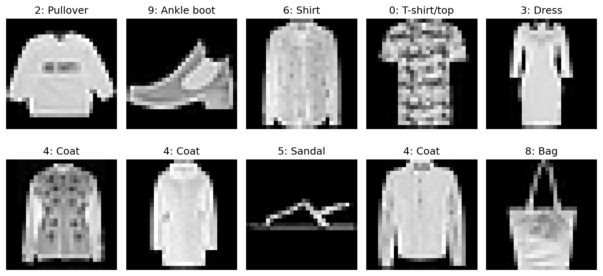
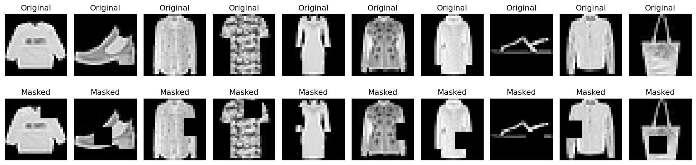
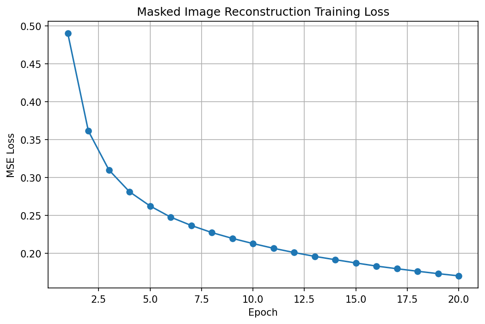
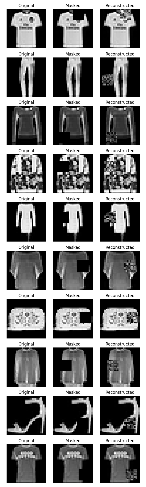
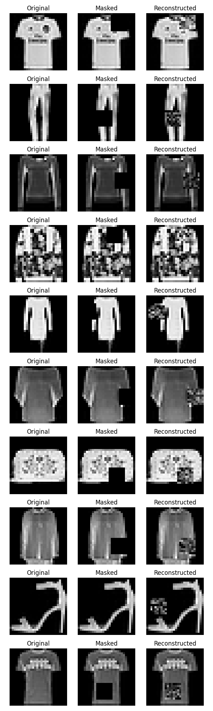
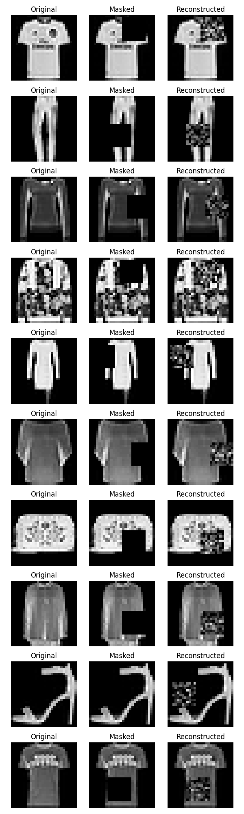
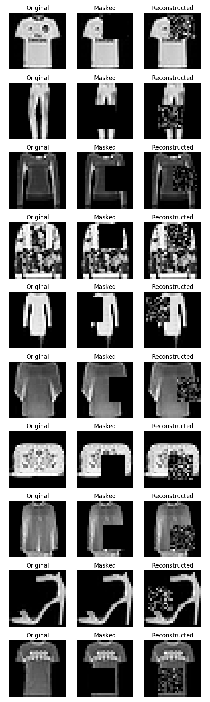
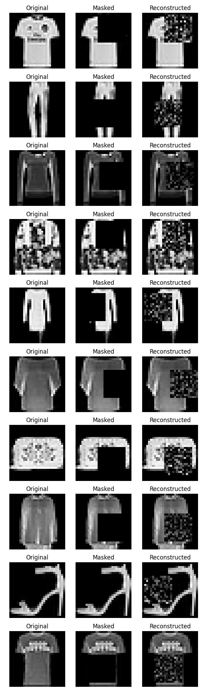
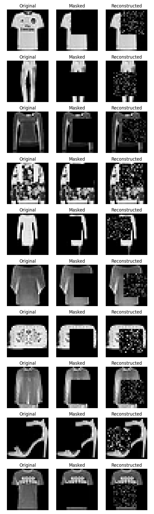

# Learning from Missing Pixels: Self-Supervised Image Reconstruction on Fashion-MNIST

## 1. Project introduction

This project is a very direct example of self-supervised learning on images. Instead of telling the model, “this is a shoe” or “this is a shirt,” we hide part of an image and ask the model to predict what was hidden.

The central idea is simple:

- the model receives an image with part of it removed,
- it must use the visible pixels to guess the missing pixels,
- the original image provides the training target.

This is different from supervised learning in an important way. In standard supervised learning, the training signal usually comes from labels such as class names. In this project, the label is not used as the target during training. The target is the actual image content that was deliberately hidden.

That is why this counts as self-supervised learning: the data creates its own supervision.

A useful mental model is this:

```
Original image
      ↓
Hide an 8×8 region
      ↓
Masked image → model input
      ↓
Original hidden pixels → target
```

The model is not being trained to classify clothing items. It is being trained to fill in missing image structure from the visible context.

---

## 2. The research question

The main question is:

> Can a neural network learn useful visual representations by predicting parts of an image that have been deliberately hidden?

A second question is also important:

> How does reconstruction quality change as more of the image is hidden?

This is interesting because the model is never explicitly told:

- “This is a coat.”
- “This is a dress.”
- “This is a shoe.”

Instead, it has to learn statistics of the image itself. It sees neighboring pixels, shapes, edges, and brightness patterns and tries to infer what likely belongs in the missing region.

So the model is not learning semantic labels. It is learning relationships between visible and hidden pixels. That is a different kind of learning signal than class labels, and it is exactly what makes the project self-supervised.

---

## 3. Dataset: Fashion-MNIST

The project uses Fashion-MNIST, which is organized as a grayscale image dataset with 10 clothing-related classes.

The repository code in `scripts/inspect_data.py` inspects the CSV dataset and confirms the following:

- training set shape: 60,000 examples
- test set shape: 10,000 examples
- image size: 28 × 28 pixels
- pixels per image: 784
- pixel values in the raw CSV files are 0–255
- each image is represented as a single row with a label column followed by 784 pixel values
- the CSV is a tabular version of the Fashion-MNIST images

The dataset layout is:

```
label,pixel1,pixel2,...,pixel784
```

So the first column is the label, and the remaining columns are the pixel intensities.

The project’s actual label map, as defined in `scripts/inspect_data.py`, is:

- 0 — T-shirt/top
- 1 — Trouser
- 2 — Pullover
- 3 — Dress
- 4 — Coat
- 5 — Sandal
- 6 — Shirt
- 7 — Sneaker
- 8 — Bag
- 9 — Ankle boot

This dataset is useful here because the clothing items have recognizable structure but the model is not trained to classify them. The images already contain the information needed for the reconstruction task.

The inspection script also reports:

- no missing values in the training or test data
- no duplicate rows in the training or test data
- the classes are represented in a fairly balanced way across the dataset

These checks matter because they tell us the training signal comes from actual image content rather than malformed data.

---

## 4. Visualize the images

The dataset is represented as numbers, but it is easiest to understand if we look at the images themselves.

The first visualization created by `scripts/inspect_data.py` is:



This figure shows a set of real Fashion-MNIST examples. Each is a 28 × 28 grayscale image, and the model ultimately sees those images as a vector of 784 numbers.

What matters here is the translation between perception and representation:

- we see a picture,
- the model sees an array of numbers,
- the image is just a structured grid of intensities.

That numerical representation is what the network learns from.

---

## 5. How we create a self-supervised task

The self-supervised signal is created by masking.

The project uses a square hidden region, starting with an 8×8 square. In the code, a random top-left corner is chosen and that block is replaced with zeros, creating an incomplete image.

The masking script is `scripts/create_masks.py`, and the saved plot is:



This visualization shows the key idea clearly:

- left: original image
- right: masked image

The model sees the masked image, but the true hidden pixels are still available in the original image and become the target.

This is the heart of the project:

```
Original image
      ↓
Mask a region
      ↓
Model input: partially visible image
      ↓
Model target: original hidden region
```

The Fashion-MNIST class label is not the target. The target is the original region that was removed from the image.

That means the network is learning from the structure of the image itself rather than from a human-provided category label.

---

## 6. Why masking?

Masking is a useful task because it forces the model to rely on the visible part of the image to predict the missing part.

The intuition is straightforward:

- the visible pixels still contain shape and texture information,
- neighboring pixels often have consistent patterns,
- the model has to infer missing intensity values based on nearby structure.

This gives the model a reason to learn relationships between pixels.

Important nuance: we should not claim that the network automatically learns semantic concepts such as “this is a shoe” or “this is a T-shirt.” The project does not train on class labels, and the task is not a classification task.

What it does learn is statistical structure. The model learns relationships between visible and hidden pixels. In other words, it learns what kinds of pixel patterns often occur near one another.

---

## 7. What exactly is the model seeing?

Each input image is a 28 × 28 grayscale image, which means:

- 784 pixels total per image
- flattened into a vector of length 784

The model then predicts the missing region:

- hidden region size: 8 × 8
- hidden pixels: 64

So the network receives 784 input values and produces 64 output values:

```
28 × 28 image
     ↓
784 input pixels
     ↓
Neural network
     ↓
64 predicted pixels
     ↓
8 × 8 hidden region
```

This matches the project implementation in `scripts/model.py` and `scripts/train.py`.

The learning problem is therefore a reconstruction problem at the pixel level: predict the pixel intensities of the hidden patch.

---

## 8. Neural network architecture

The model is intentionally simple and is implemented from scratch with NumPy.

The architecture is:

- input layer: 784 units
- hidden layer: 128 units
- output layer: 64 units

In the code, this is defined as:

```
784 → 128 → 64
```

The actual implementation lives in `scripts/model.py`:

- `MaskedImageModel`
- `W1` and `b1` for the input-to-hidden layer
- `W2` and `b2` for the hidden-to-output layer
- ReLU activation in the hidden layer
- a linear output layer for the predicted hidden pixels

The output is linear because the model predicts continuous pixel values in the range 0–1 after normalization. This is not a classification network. It is predicting numeric intensities, not class probabilities.

Why this architecture?

- the input is high-dimensional but still manageable,
- a single hidden layer gives enough capacity to learn useful pixel relationships,
- the network is small enough to understand and inspect directly,
- it is consistent with the project goal of learning a basic representation from masked-image reconstruction.

This is not a large deep learning model; it is a small, from-scratch neural network designed to clearly demonstrate the learning process.

---

## 9. Forward pass

When an image enters the network, it follows a standard forward pass:

1. the flattened 784-dimensional image vector is multiplied by learned weights,
2. a bias is added,
3. the result is passed through a ReLU activation,
4. the hidden representation is transformed again into a 64-dimensional output,
5. the output is the model’s prediction for the missing 8×8 patch.

In other words, the model is making a current guess for what the hidden pixels should be.

The very first pass is not expected to be good. The network starts with random weights and must learn from repeated comparisons between its guesses and the true hidden pixels.

---

## 10. Loss function

The model needs a measurable way to know how wrong it is.

The project uses mean squared error (MSE):

- compare each predicted hidden pixel to the actual hidden pixel,
- square the difference,
- average those squared errors over all 64 pixels.

Conceptually, this answers:

> “How far was my reconstruction from the correct hidden pixels?”

This is exactly the signal used during learning. A lower MSE means the predictions are closer to the true values.

No heavy derivation is needed here. The project is not trying to teach advanced optimization theory; it is trying to show how a model gets feedback from a pixel-level reconstruction task.

---

## 11. Backpropagation and learning

The learning process is implemented in `MaskedImageModel.backward()` in `scripts/model.py`.

The sequence is:

1. the network makes a prediction,
2. the loss compares that prediction with the real hidden pixels,
3. the error is propagated backward through the network,
4. the gradients tell the model how each weight contributed to the error,
5. the parameters are updated with gradient descent.

This is the standard idea behind backpropagation:

> Make a guess → measure the error → adjust the weights in the direction that reduces the error → repeat.

The learning rate in the project is 0.001, and the loop runs for 20 epochs. Each training step uses batches of 64 examples, as defined in `scripts/train.py`.

That means the model is repeatedly seeing masked images, comparing them to the real hidden patches, and adjusting its weights so that future reconstructions improve.

---

## 12. Training

The main training script is `scripts/train.py`.

The actual training setup is:

- training examples used for the initial experiment: 10,000
- mask size: 8×8
- pixels normalized from 0–255 to 0–1
- epochs: 20
- batch size: 64
- learning rate: 0.001
- random seed: 42

The training loop does the following:

1. load the Fashion-MNIST CSV data,
2. normalize the pixel values to 0–1,
3. randomly choose a square mask position,
4. replace the hidden region with zeros,
5. save the original hidden region as the target,
6. run the model on masked inputs,
7. compute the MSE reconstruction loss,
8. backpropagate and update the parameters,
9. repeat across epochs.

This is the training objective for the project: reconstruct the missing region from the visible context.

The training loss plot saved by the script is:



This curve shows the model reducing the reconstruction error over time. The actual training log from the repository confirms this trend:

- epoch 1: 0.490365
- epoch 10: 0.212633
- epoch 20: 0.169963

This is not proof that the model has learned a human-level understanding of clothing categories. It shows that the model has learned to make better pixel-level predictions over time.

---

## 13. Saving the trained model

After training, the model parameters are saved to:

- `experiments/model_weights.npz`

This is important because it lets the project evaluate the trained model on unseen images without retraining it. The saved weights include:

- `W1`
- `b1`
- `W2`
- `b2`

This means the model can be loaded later and tested on new masked examples.

---

## 14. Evaluation on unseen images

The evaluation pipeline is in `scripts/evaluate.py`.

The important separation is:

- training images → used to update parameters
- test images → used to evaluate the learned behavior

The code loads the Fashion-MNIST test set and then creates masked versions of test images. The trained model predicts the missing region, and the script calculates the test MSE.

The reconstruction visualization produced by the evaluation scripts is:



This figure shows three stages for each example:

- original image
- masked image
- reconstructed image

What is being shown here is the model’s output on previously unseen images. The model is trying to fill in the region it cannot see.

The reconstructed image is not perfect, but the model clearly captures some structure. There are bright and dark regions, object silhouettes, and overall outlines that line up with the original image more than random guessing would.

However, we should be careful with language. The results suggest that the model learned some statistical relationships between visible and hidden pixels. They do not show that the network understands clothing categories or that it has semantic awareness of objects.

---

## 15. Why are the reconstructions blurry or inaccurate?

This is one of the most important findings in the project.

The reconstructions are not perfect because the model has only partial information. If a large region is hidden, the task becomes much harder. In many cases, there are multiple possible completions that look reasonable, and MSE encourages the network to choose a smoother, average prediction rather than a sharp, exact one.

That is why the reconstructed patches often look blurry or patchy. The model is trying to minimize squared pixel error, not to copy each exact original pixel perfectly.

This is not a failure of the entire idea. It tells us something important about reconstruction tasks:

- when information is removed, the network is forced to infer missing content,
- the guess may be plausible but not exact,
- the amount of uncertainty increases as the missing region grows.

This is exactly the kind of behavior we want to study in a self-supervised setting.

---

## 16. Progressive masking experiment

This is the major experiment of the project.

The question is:

> What happens when we hide progressively larger parts of the image?

The repository uses the following square mask sizes:

- 8×8
- 10×10
- 12×12
- 14×14
- 16×16

The experiment is implemented in `scripts/mask_size_experiment.py`.

One important detail: a fresh model is trained for each mask size. The output dimension changes with the mask size, so the architecture is effectively adapted to the prediction target. This is necessary because:

- an 8×8 hidden region predicts 64 pixels,
- a 16×16 hidden region predicts 256 pixels,
- the model output must match the number of missing pixels.

The experiment created a separate model for each mask size, and each model was evaluated on test data after training.

### Actual mask-size results

These values come directly from the saved result files in each experiment folder:

| Mask size | Hidden pixels | Approx. image area hidden | Test MSE |
| --- | ---: | ---: | ---: |
| 8×8 | 64 | 8.2% | 0.154078 |
| 10×10 | 100 | 12.8% | 0.176499 |
| 12×12 | 144 | 18.4% | 0.184678 |
| 14×14 | 196 | 25.0% | 0.188410 |
| 16×16 | 256 | 32.7% | 0.212716 |

The trend is clear:

- as more of the image is hidden, the task becomes harder,
- the model has less visible information to use,
- the reconstruction loss goes up.

The 8×8 model has the lowest test MSE among these runs, while the 16×16 model has the highest.

### Reconstruction images by mask size

The repository contains the saved reconstruction figures for each experiment:











What these images show is the same pattern repeated: as the hidden region gets larger, the reconstruction becomes less precise and more uncertain. The model still produces a plausible overall image structure, but the details are weaker and the average error increases.

---

## 17. Quantitative results

The central quantitative result is this:

> Reconstruction becomes more difficult as more of the image is hidden.

This is not a universal law for all models or all masking schemes. It is a project-specific observation from this Fashion-MNIST reconstruction setup.

The actual test MSE values are:

- 8×8: 0.154078
- 10×10: 0.176499
- 12×12: 0.184678
- 14×14: 0.188410
- 16×16: 0.212716

So the model performs best when only a small region is hidden and increasingly worse as the missing region grows.

This is exactly what we would expect from a model trying to infer missing pixels from context alone. It becomes much harder to recover detail once a large fraction of the image is removed.

---

## 18. What did the model actually learn?

The most accurate interpretation is this:

The model learned to use visible pixel patterns to make predictions about missing pixel patterns.

That means it learned statistical relationships in the image data. It discovered that nearby pixels and local structures often co-occur in particular ways. It did not learn a symbolic label like “shoe” or “shirt,” and the project never trained it to do that.

A carefully stated version is:

> The network learned some structure in the visual data, enough to generate plausible reconstructions for missing regions.

This is a genuine representation-learning result, but it is a pixel-level representation rather than a human-interpretable semantic representation.

It is also important to be precise: the project does not establish that the learned features are useful for downstream classification, because the project does not evaluate a classification task using the learned representation.

---

## 19. Why this is self-supervised learning

This project is a direct example of self-supervised learning because the supervision is generated from the data itself.

No human annotator labeled the missing patch. No class label told the network what the missing region should contain.

Instead:

- the original image exists,
- part of that image is hidden,
- the hidden region is treated as the target,
- the model learns by trying to reconstruct it.

That is the core idea of self-supervised learning in this project: the data itself provide the training signal.

The project is not using the Fashion-MNIST labels for training. The labels are available in the dataset, but the model is not trying to classify them. It is trying to restore missing image content.

---

## 20. Limitations

This project has several important limitations.

### Reconstruction difficulty

Even when the model predicts something reasonable, it often cannot recover fine details exactly. The missing region is fundamentally underconstrained, especially when the mask is large.

### Simple architecture

The architecture is intentionally small: 784 → 128 → 64. It is a useful teaching model, but it is not a modern image model. It is not designed to capture all of the complexity of image structure at scale.

### Pixel-level objective

MSE rewards average pixel agreement, not necessarily perceptual similarity. A reconstruction may be visually plausible but still have a nontrivial MSE.

### Limited training subset

The initial training experiment used 10,000 training examples, not the full 60,000-image training set. This is enough for learning the basic task, but it limits the model’s exposure to the broader data distribution.

### No downstream representation evaluation

The project does not test whether the learned representation is useful for a separate classification task. So we should not claim that the learned features are validated as a general-purpose representation for clothing recognition.

### Fixed masking setup

The project primarily investigates square masks and varying mask size. It does not test many alternative masking strategies such as random patch patterns, irregular occlusions, or larger-scale masking schemes.

---

## 21. What I learned

This project taught a very concrete lesson about self-supervised learning:

- image data can generate supervision without labels,
- removing part of an image creates a learning task from raw pixels,
- a small neural network can learn useful local structure from this task,
- pixel reconstruction is a practical way to study representation learning,
- training signal quality depends strongly on how much information is hidden,
- simple networks can learn meaningful relationships but also show clear limits,
- evaluation must distinguish between training behavior and generalization.

In practical terms, the project made the following concrete ideas feel real:

- an image is a numerical array,
- masking makes a prediction problem out of raw data,
- loss tells the model what to improve,
- backpropagation turns that error into parameter updates,
- reconstruction quality changes as the task gets harder,
- representation learning is not the same as semantic understanding.

---

## 22. Conclusion

The question this project asked was:

> Can a neural network learn useful visual representations by predicting parts of an image that have been deliberately hidden?

The evidence from the repository supports a careful yes.

The model learned statistical relationships between visible and hidden pixel patterns, and it was able to reconstruct missing image regions better than random guessing. The training loss decreased steadily, and the model produced plausible reconstructions on unseen test images.

At the same time, the results also show the limits of this approach. As the hidden region became larger, the reconstruction quality worsened. The model learned local structure and pixel relationships, but not human-like semantic understanding of clothing categories.

The most accurate summary is:

> The model learned statistical relationships between visible and hidden pixel patterns, producing plausible but increasingly inaccurate reconstructions as more of the image was hidden.

That is a strong and precise conclusion grounded in the actual project results.

---

## 23. Project structure

The actual repository structure in this workspace is:

```text
fashion-mnist/
├── datasets/
│   ├── fashion-mnist_train.csv
│   ├── fashion-mnist_test.csv
│   ├── train-images-idx3-ubyte
│   ├── train-labels-idx1-ubyte
│   ├── t10k-images-idx3-ubyte
│   └── t10k-labels-idx1-ubyte
├── experiments/
│   ├── sample_images.png
│   ├── masking_examples.png
│   ├── training_loss.png
│   ├── reconstruction_examples.png
│   ├── model_weights.npz
│   ├── 8x8_mask/
│   │   ├── model_weights.npz
│   │   ├── reconstruction.png
│   │   └── results.txt
│   ├── 10x10_mask/
│   │   ├── model_weights.npz
│   │   ├── reconstruction.png
│   │   └── results.txt
│   ├── 12x12_mask/
│   │   ├── model_weights.npz
│   │   ├── reconstruction.png
│   │   └── results.txt
│   ├── 14x14_mask/
│   │   ├── model_weights.npz
│   │   ├── reconstruction.png
│   │   └── results.txt
│   └── 16x16_mask/
│       ├── model_weights.npz
│       ├── reconstruction.png
│       └── results.txt
├── raw-readme-notes.md
├── readme.md
├── scripts/
│   ├── inspect_data.py
│   ├── create_masks.py
│   ├── model.py
│   ├── train.py
│   ├── evaluate.py
│   └── mask_size_experiment.py
└── dataset inspection outputs and intermediate experiment artifacts
```

This repository does not include a separate `plots/` directory. The visualizations are saved under `experiments/`.

The current repository snapshot also does not include a `requirements.txt`; the scripts rely on the standard scientific Python stack used in this environment, especially `pandas`, `numpy`, and `matplotlib`.

---

## 24. How to run

Run the scripts from the repository root.

### Inspect the dataset

```bash
python scripts/inspect_data.py
```

This script checks:

- data shape,
- number of columns,
- missing values,
- duplicates,
- label distribution,
- sample Fashion-MNIST image visualization.

### Create masking examples

```bash
python scripts/create_masks.py
```

This creates the masked-image demonstration plot that shows how a square region is hidden.

### Train the model

```bash
python scripts/train.py
```

This script:

- loads the training set,
- normalizes pixels,
- creates masked inputs and hidden-region targets,
- trains the 784 → 128 → 64 model,
- saves the training loss plot,
- saves the trained weights to `experiments/model_weights.npz`.

### Evaluate the model

```bash
python scripts/evaluate.py
```

This script loads the trained model and reconstructs masked test images, producing the comparison figure of original, masked, and reconstructed images.

### Run the mask-size experiment

```bash
python scripts/mask_size_experiment.py
```

This trains separate models for 8×8, 10×10, 12×12, 14×14, and 16×16 mask sizes and saves the results under `experiments/<mask>_mask/`.

---

## Final takeaway

This project is a good example of how self-supervised learning can be built from the data itself. We did not use Fashion-MNIST labels as the training target. Instead, we created a task from the images themselves: hide part of an image and train a neural network to reconstruct it.

What the model learned was not a human label or a semantic category. It learned how pixel patterns relate to nearby pixel patterns. That is a valid form of representation learning, and it is exactly the kind of learning signal that self-supervised methods rely on.

The broader story of the project is simple and coherent:

> We wanted to know whether a model could learn from an image itself → we hid part of the image → trained a neural network to reconstruct it → evaluated it on unseen images → increased the amount hidden → observed reconstruction becoming harder → interpreted what the model learned and where it failed.

That is the project in one sentence, and it is exactly the story captured by the repository’s code, outputs, and experiments.
